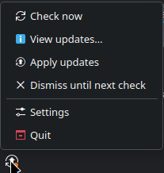
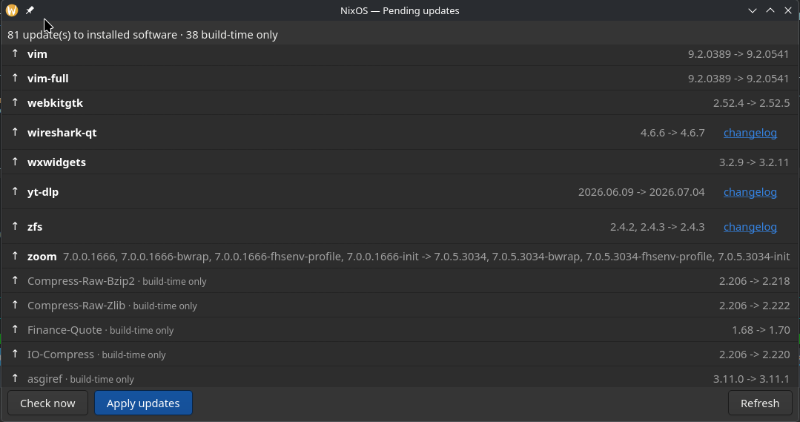
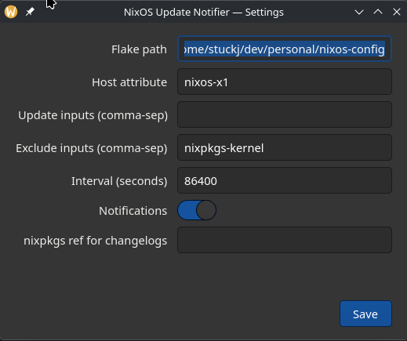

# nixos-update-notifier

A system-tray update notifier for **flake-based NixOS** — the Ubuntu update notifier, but
for NixOS flakes.

It sits in your tray, periodically checks whether advancing your flake inputs would change
your system, shows you a `name: old -> new` package list **without downloading anything**,
and applies updates on request through an authenticated `nixos-rebuild`.

Built for **KDE Plasma 6 on Wayland** (native StatusNotifierItem tray).



Everything is driven from the tray menu.



The update list separates **updates to software you actually have installed** from
**build-time-only** dependencies — compilers and build inputs that a derivation-closure
diff necessarily includes but which are never installed on your system. Changelog links
appear where nixpkgs provides `meta.changelog`.



Settings are editable from the tray, or in `config.toml` directly.

---

## Features

- **Tray icon** that reflects state: up to date / checking / updates available / error.
- **Background checks** on a configurable interval that **download nothing** — no package
  builds are fetched just to tell you an update exists.
- **Desktop notifications** when new updates appear.
- **Update list** showing each change as `name: old -> new`, with a changelog link where
  nixpkgs provides one.
- **Apply** from the menu: installs the new `flake.lock` and runs `nixos-rebuild switch`
  behind a polkit prompt, then tells you if a reboot is warranted. A progress window shows
  downloads and builds as they happen (paths, bytes, speed) and can cancel.
- **New NixOS releases** are announced once, and can be previewed and upgraded to from the
  update window — a separate, explicit step that never happens as part of Apply.
- **Failures explain themselves**: a failed check shows nix's error, a suggested fix for
  common cases (an insecure or unfree package), and the full output to copy.
- **Pinned inputs are never advanced** — an `exclude_inputs` list protects things like a
  rev-pinned `nixpkgs-kernel` that provides your kernel + ZFS.
- Fully config-driven; nothing is hardcoded to a particular machine.

---

## Requirements

- NixOS managed as a flake, rebuilt with `nixos-rebuild switch --flake <path>#<host>`.
- A running **StatusNotifierHost** — KDE Plasma provides one; on wlroots compositors use
  something like `waybar`.
- `nix` with flakes enabled, and `polkit`/`pkexec` for applying updates.

---

## Install

The flake exposes `packages.<system>.default`, a **home-manager module**, a **NixOS
module**, and a devShell.

### 1. Add it as a flake input

```nix
# in your system flake.nix
{
  inputs = {
    nixpkgs.url = "github:NixOS/nixpkgs/nixos-unstable";
    home-manager.url = "github:nix-community/home-manager";

    nixos-update-notifier.url = "github:stuckj/nixos-update-notifier";
    nixos-update-notifier.inputs.nixpkgs.follows = "nixpkgs";
  };
}
```

The `follows` line is worth keeping. This flake tracks `nixos-unstable` for its own dev
shell and CI; `follows` points its nixpkgs at yours so you don't evaluate a second nixpkgs
tree — a duplicate glibc, GTK4 and everything beneath them — just to install one tool.

Both modules already build the package from *your* `pkgs`, so the module path is unaffected
either way; `follows` matters when you reference `packages.<system>.default` directly. Any
channel works — the package is tested against stable `nixos-26.05` as well as unstable.

If you'd rather have it as an ordinary package attribute, apply the overlay:

```nix
nixpkgs.overlays = [ inputs.nixos-update-notifier.overlays.default ];
# then: pkgs.nixos-update-notifier
```

To run from a local clone instead:

```nix
nixos-update-notifier.url = "git+file:///home/you/dev/personal/nixos-update-notifier";
# or: "path:/home/you/dev/personal/nixos-update-notifier"
```

### 2. Enable the home-manager module

This is the main way to use it — the tray is a per-user thing.

```nix
{ inputs, ... }:
{
  imports = [ inputs.nixos-update-notifier.homeManagerModules.default ];

  services.nixos-update-notifier = {
    enable = true;
    flakePath = "/home/you/dev/personal/nixos-config";
    hostAttr = "nixos-x1";

    # Advance everything EXCEPT a rev-pinned input:
    excludeInputs = [ "nixpkgs-kernel" ];
    # …or allow-list specific inputs instead:
    # updateInputs = [ "nixpkgs" "home-manager" ];

    interval = 21600;   # seconds (6h)
    notify = true;
  };
}
```

That installs both binaries, writes `~/.config/nixos-update-notifier/config.toml`, and runs
a user systemd service tied to your graphical session.

### 3. Optional: the NixOS module

Only needed to install the package system-wide, or to grant passwordless apply (read
[Security](#security) first — it is off by default for good reason).

```nix
{ inputs, ... }:
{
  imports = [ inputs.nixos-update-notifier.nixosModules.default ];
  services.nixos-update-notifier.enable = true;
}
```

---

## Configuration

The home-manager module generates the config for you. Running standalone, copy
[`config.example.toml`](config.example.toml) to
`~/.config/nixos-update-notifier/config.toml`.

| Option | Meaning |
|---|---|
| `flake_path` | Absolute path to your flake repo. **Required.** |
| `host_attr` | The `nixosConfigurations.<name>` to build. **Required.** |
| `update_inputs` | Inputs to advance. Empty = all of them, minus the excludes. |
| `exclude_inputs` | Inputs to **never** advance, e.g. a pinned kernel. |
| `interval` | Seconds between checks (minimum 60). |
| `notify` | Whether to show desktop notifications. |
| `check_releases` | Look for new NixOS stable releases (default on). Notifies only; see [Release upgrades](#release-upgrades). |
| `release_inputs` | Inputs a release upgrade moves to the new release branch. Default `["nixpkgs", "home-manager"]`. |
| `nixpkgs_ref_for_changelogs` | Which nixpkgs to resolve changelog links against. Defaults to the one in the candidate lock — the revision the pending update would install — so links match the version offered and nothing is downloaded to read them. Override only for a flake that names its nixpkgs something else, and pin what you set. |
| `[icons]` | Icon name per state — see the example file before changing. |

Settings can also be edited from the tray's **Settings** window.

---

## Usage

The tray menu covers everything: **Check now**, **View updates…**, **Apply updates**,
**Dismiss until next check**, **Settings**, **Quit**. Left-click opens the update list.
While an apply runs, **Show apply progress…** reopens its progress window.

Only one daemon runs at a time. Starting it again (from the app menu, say) opens the running
daemon's update window instead.

There is also a CLI, useful for scripting or a quick look:

```console
$ nixos-update-notifier check          # one-shot check; downloads nothing
$ nixos-update-notifier check --json   # machine-readable
$ nixos-update-notifier check --exact  # exact runtime diff (this DOWNLOADS: it builds)
```

Force the running daemon to check immediately:

```console
$ systemctl --user kill -s SIGUSR1 nixos-update-notifier.service
```

### Applying updates

**Apply updates** installs the new `flake.lock` into your repo and runs
`nixos-rebuild switch` behind a polkit prompt. Your previous lock is backed up first and
restored automatically if the rebuild fails or you cancel the prompt.

Those backups are written next to your lock as `flake.lock.bak.<epoch>` (and
`flake.nix.bak.<epoch>` for a release upgrade), and only the newest three of each are kept.
They are working files, not history — git already records your previous locks — so add
this to your config repo's `.gitignore`:

```gitignore
flake.lock.bak.*
flake.nix.bak.*
```

The progress window shows how many paths have been downloaded and built, bytes and speed,
and what is being fetched right now, and warns if downloads stop moving. **Details** has
the full log. Cancel is safe while building and downloading.

If `flake.lock` ends up ahead of the running system — an apply that never finished, or a
hand-run `nix flake update` — the tray shows **not applied** rather than "up to date". The
same state appears for configuration changes you have not rebuilt yet, including a new
commit if your config embeds its git revision (`system.configurationRevision`). Apply
rebuilds from the repo as it is. When the newest lock backup is exactly what is running,
the update window also offers **Revert flake.lock**, which puts it back (backing up the
current lock first).

### Release upgrades

When a new NixOS stable release is out (from the first day of the month after its
release), you get one notification, and the update window shows it above the package list
with a choice of target if several are newer than yours. **Preview upgrade** moves the
release inputs (`release_inputs`, minus `exclude_inputs`) from e.g. `nixos-26.05` to
`nixos-26.11` and `release-26.05` to `release-26.11` in a copy of `flake.nix`, relocks
them, and shows the package diff — nothing in your repo changes. **Upgrade to NixOS …**
then backs up and installs the new `flake.nix` and `flake.lock` and runs the rebuild; both
are restored if it fails.

- `system.stateVersion` / `home.stateVersion` are never changed, and should not be.
- Read the release notes first: releases often need configuration changes. Upgrading one
  release at a time is safest, since removed options usually warn for one release first.
- Only literal branch names are rewritten. If yours are built from a variable, or another
  input tracks the same branch but is not being upgraded, the preview says so and you
  change `flake.nix` by hand.
- The release you are on is read from the first of `release_inputs` (normally nixpkgs). A
  flake whose nixpkgs tracks `nixos-unstable` or a `-small` channel, or excludes it, is not
  offered an upgrade. Turn the check off with `check_releases = false`.

If you want to see what a rebuild would do before trusting it:

```console
$ nixos-rebuild dry-activate --flake <repo>#<host>
```

That runs the real activation logic against your running system and reports which units
would start, stop and restart, without switching.

`nixos-rebuild build-vm` boots the new configuration in a VM, which is useful for
software-only changes. Be aware it only virtualises the **root** filesystem: if your config
declares swap, extra filesystems or a hibernation resume device on real hardware (e.g.
generated by disko), the VM will hang waiting for devices that don't exist. Overriding them
for the VM build only:

```nix
virtualisation.vmVariant = {
  swapDevices = lib.mkForce [ ];
  boot.resumeDevice = lib.mkForce "";
  virtualisation = { memorySize = 4096; cores = 4; };
};
```

For a hardware-specific config (ZFS root, disko partitioning), `dry-activate` is usually
the more informative check.

---

## What the states mean

| Tray state | Meaning |
|---|---|
| **Up to date** | Advancing your inputs would not change the system. |
| **Checking** | A check is running. |
| **Configuration changes** | Inputs moved, but no package changed version — usually a module regenerating its config. Safe to apply, not urgent. |
| **Updates available** | One or more packages changed version. The window lists them. |
| **Applying** | A rebuild is running. Checks wait until it finishes. |
| **Not applied** | Nothing newer upstream, but your flake (lock or config) is not what is running. Apply rebuilds it. |
| **Error** | The last check or apply failed. The update window shows why, with a suggested fix where one is known. |

A **⚠ input skipped** banner in the update window means one of your flake inputs could not
be advanced (e.g. a local fork whose repo has moved). The rest were still checked — but
"up to date" means less while an input is being skipped, so it is worth fixing.

---

## Security

**One operation needs root:** `nixos-rebuild switch`, which activates the new system.
Everything else — checking, diffing, the tray, notifications, the GTK window — runs as your
normal user. Even downloading and building doesn't need the app to be root, because `nix`
talks to the already-root nix-daemon.

The privileged helper is correspondingly tiny: it takes **no file paths and no pass-through
arguments**, only which flake ref to activate. The new `flake.lock` is written by the
*unprivileged* daemon, since it's your own file. A failed or cancelled apply restores it.

**Before enabling `polkit.passwordlessUsers`, understand this:** root evaluates the flake
in your checkout, and that checkout is writable by you. Anyone who can run code as your user
can edit `flake.nix` and have root execute it at the next apply. That is inherent to
"rebuild my system from my flake" — the same trust you extend running `sudo nixos-rebuild`
from a repo you can edit.

The polkit prompt is what keeps that safe: you're present and approving. **Enabling
passwordless apply removes that check and is equivalent to `NOPASSWD` sudo for that user.**
It's off by default. Only enable it if you'd also be comfortable granting passwordless root.

---

## Troubleshooting

**The tray icon is blank or missing.** The icon names must exist in your icon theme; an
unresolvable name renders as an empty gap with nothing logged. The defaults are Breeze
names. On another desktop, override them under `[icons]` in the config.

**The tray icon never appears at all.** Check a StatusNotifierHost is running — on KDE it's
part of Plasma. Verify the service is up with
`systemctl --user status nixos-update-notifier`.

**The update window says "Daemon not running".** The GTK window is a client; start the
service with `systemctl --user start nixos-update-notifier`.

**Checks fail.** Open **View updates…**: it shows the step that failed and nix's error,
with **Show details** / **Copy** for the full output (also in
`journalctl --user -u nixos-update-notifier -e`). A common cause after a nixpkgs bump is a
package marked insecure or unfree, for which the window suggests the setting to change. A
flake input that can't be fetched appears as a ⚠ banner naming the input.

**A check takes a long time.** The first check after a reboot evaluates your whole system
config and can take a minute or more. The tray stays responsive throughout.

---

## Contributing

Architecture, internals, and development setup are in
[CONTRIBUTING.md](CONTRIBUTING.md). Release process is in [RELEASING.md](RELEASING.md).

## License

MIT — see [LICENSE](LICENSE).
